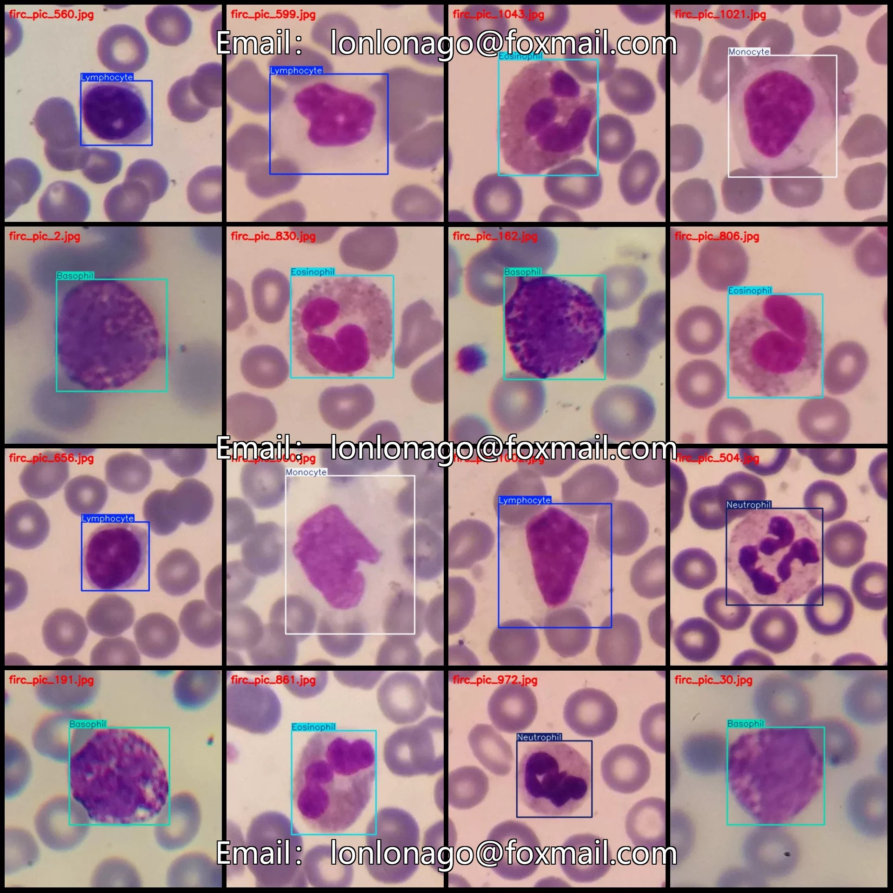
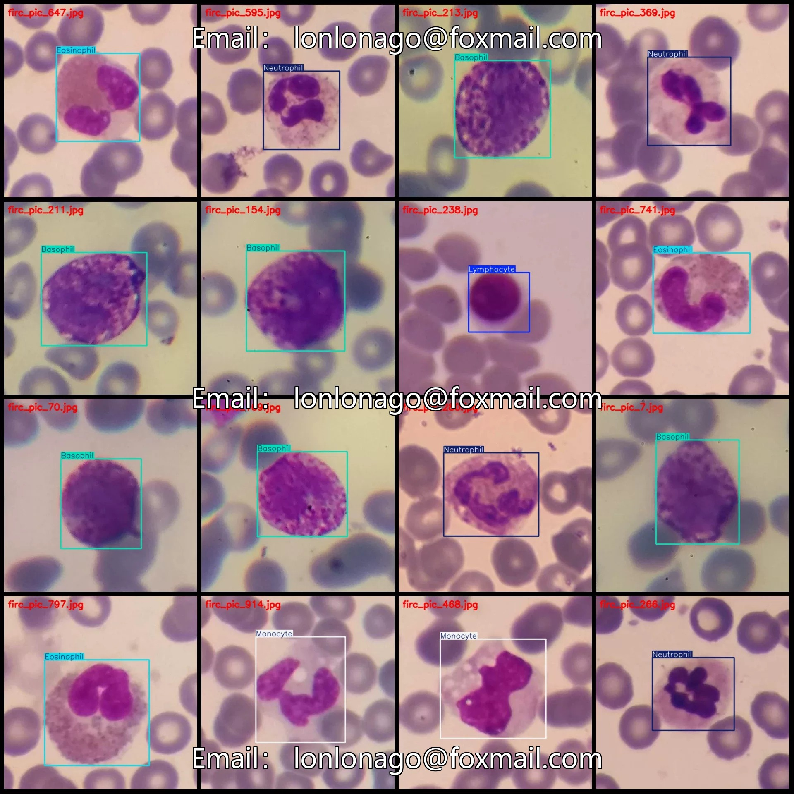
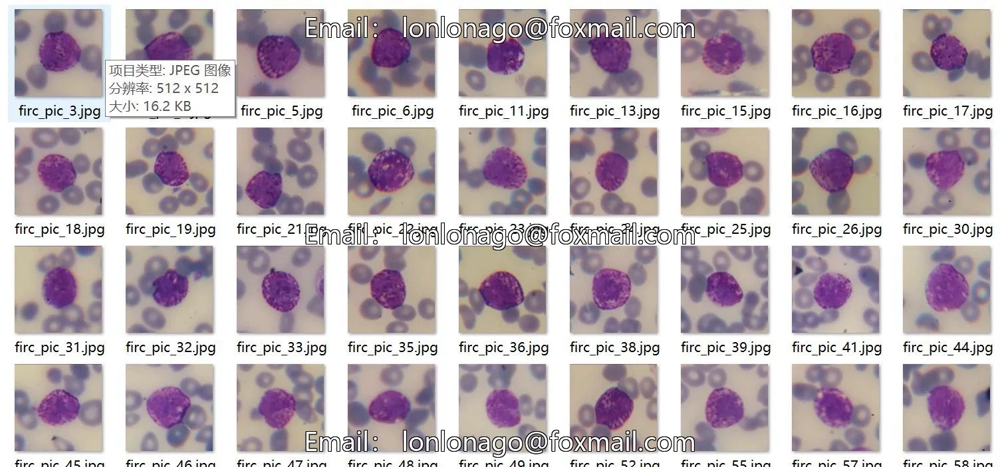
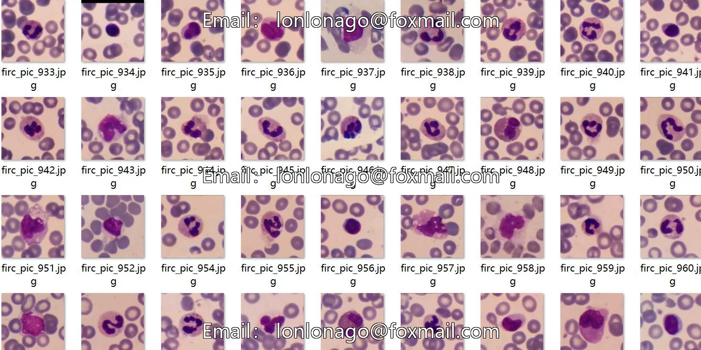
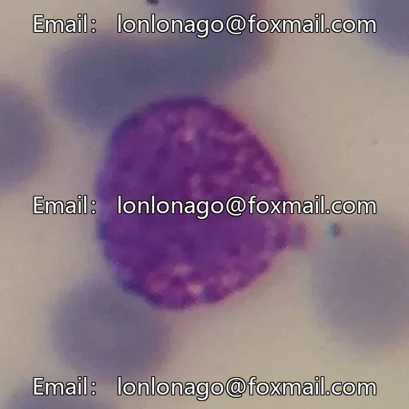
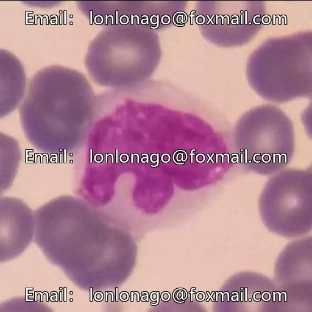
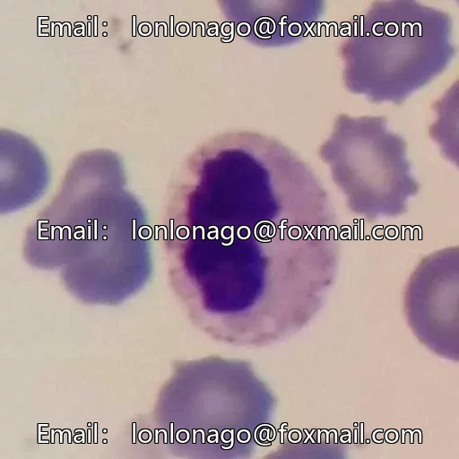

# Five different micro-image datasets of leukocyte detection in VOC+YOLO format, 1145

## Body

Five different leukocyte micro-image detection datasets in VOC+YOLO format with 1145 images in 5 categories
Tips: Due to the dataset's replicability, please confirm compliance before purchasing.
Dataset format: Pascal VOC format + YOLO format (txt file without segmentation paths, only containing jpg images and corresponding VOC format xml files and yolo format txt files)
Number of images (number of jpg files): 1145
Number of annotations (number of xml files): 1145
Number of annotations (number of txt files): 1145
Number of annotation categories: 5

Annotation Category Names: ["Basophil", "Eosinophil", "Lymphocyte", "Monocyte", "Neutrophil
Each category has its number of bounding boxes and the number of images it occupies.
Basophil (Basiphilia) - Number of bounding boxes = 218, Number of images = 218
Eosinophil (Eosinophilia) - Number of bounding boxes = 203, Number of images = 201
Lymphocyte (Lymphocytosis) - Number of bounding boxes = 242, Number of images = 242

Monocyte (Monocytes) Frames = 243, Image Count = 242
Neutrophil (Neutrophils) Frames = 242, Image Count = 242
Total Frames: 1148
Image Resolution: 512x512
Labeling Tool: labelImg
Labeling Rules: Draw a rectangle around the category.
Important Note: The dataset does not have separate training, validation, or test sets; you will need to partition them yourself.
Special Remark: This dataset does not guarantee the accuracy of the trained models or weight files.

## Images

## Payment

Here is a pay link on Stripe ( https://buy.stripe.com/3cs8yP7sY87d0vu9AB ). Please contact me lonlonago@foxmail.com after funding $89, and I will send you a complete data files , thank you!

